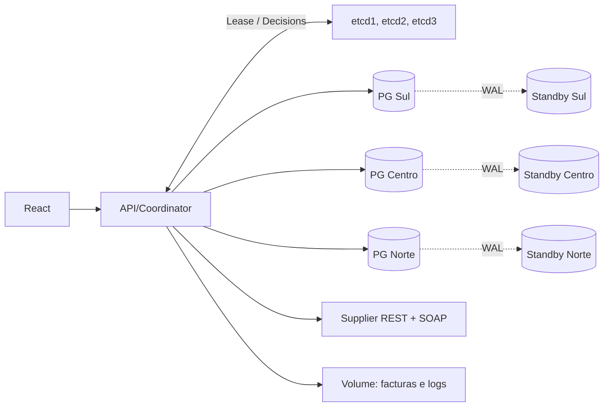
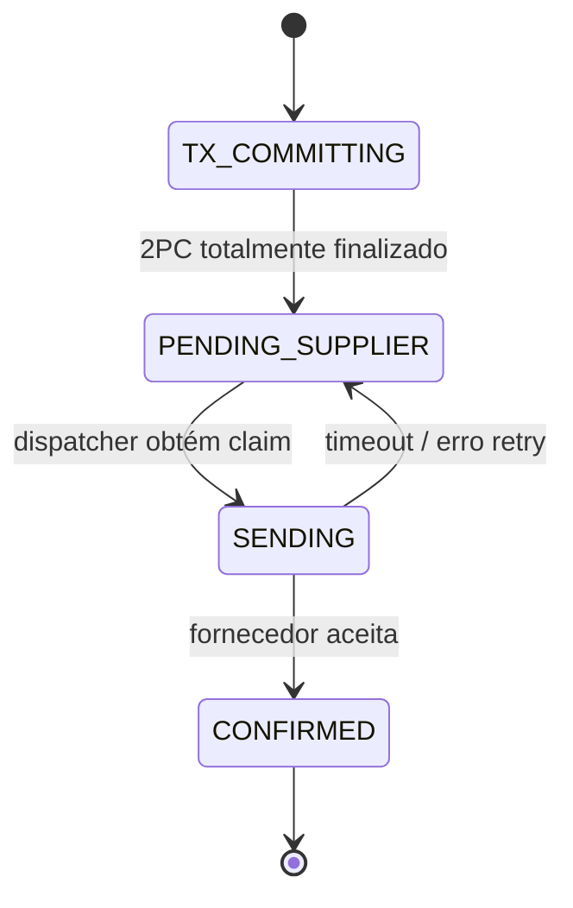
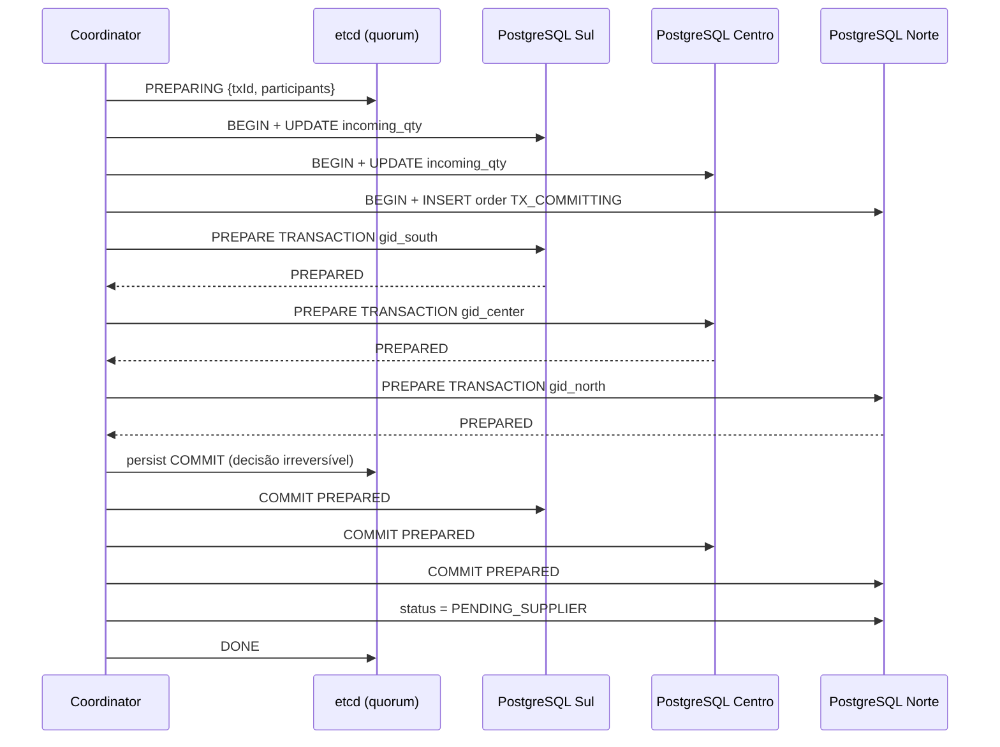

> **Actualização v0.2:** Este documento descreve principalmente a arquitectura-base v0.1. O portal regional autenticado, a recepção e os novos endpoints estão documentados em `NOVIDADES_V02.md`, `COMANDOS_OPERACAO.md` e no README principal.

# Arquitectura do SCAD Coordena MVP

## 1. Separação entre arquitectura-alvo e MVP

A arquitectura-alvo da proposta SCAD Coordena contém: agentes independentes, coordenador redundante, PostgreSQL fragmentado/replicado, etcd com consenso, sincronização NTP, DFS GlusterFS com três bricks, gateways de fornecedor, auditoria e dashboard.

**A v0.1 implementa:** API/coordenador, três agentes regionais independentes, três primários PostgreSQL com três standbys físicos, três membros etcd, REST/SOAP simulados, monitorização automática, PDFs num volume local e React.

| Requisito do teste | Componente MVP | Limite |
|---|---|---|
| SOD — concorrência | Lock etcd por fornecedor/lote + UNIQUE PostgreSQL | Sem fencing tokens persistidos nos escritórios de dados |
| SOD — relógio | UTC / host Docker | Não há NTP demonstrado entre hosts independentes |
| SBDD — fragmentação | Três clusters PostgreSQL primários com fragmentos independentes | Dados do catálogo de produtos duplicados como seed, sem catálogo global |
| SBDD — replicação | Um standby por primário usando WAL/streaming | Assíncrona, sem promoção/roteamento automáticos |
| SBDD — atomicidade | Coordenador 2PC, decisões em etcd e recuperação | Não é um Transaction Manager auditado para produção |
| DFS | Volume local de facturas e logs | **Não constitui DFS nem tolerância à perda do host** |
| Comunicação interna | REST API unificada + etcd | Agentes enviam alertas HTTP; não possuem canal RPC entre si |
| SWD — fornecedores | REST/JSON e SOAP/XML com WSDL e retries | Fornecedores simulados |

## 2. Diagrama de topologia do laboratório

**Nota de desenho:** os 15 containers na versão Compose estão no mesmo host. São serviços separados, não hosts fisicamente independentes. O armazenamento e os discos do host constituem um único domínio de falha.

## 3. Entidades e invariantes

### `stock_positions` (em cada região)

| Campo | Papel |
|---|---|
| `product_id` | Chave local do produto |
| `region` | Identificação do shard |
| `on_hand` | Stock físico, nunca negativo |
| `minimum_stock` | Limite de reposição |
| `target_stock` | Objectivo após reposição |
| `incoming_qty` | Quantidade encomendada, ainda não recebida |
| `reorder_cycle` | Nova geração de evento ao cruzar o mínimo |

**Invariantes:** `on_hand >= 0`, `incoming_qty >= 0`, `target_stock > minimum_stock` e uma só posição por produto/região. Para evitar múltiplas compras automáticas, `incoming_qty` entra na verificação do mínimo.

### `purchase_orders` (catálogo no PostgreSQL Norte)

Campos: `id`, `supplier_id`, `batch_id`, `items`, `status`, `external_order_id`, `invoice_path`, `retry_count`, `next_retry_at`, `last_error`, timestamps.

**Invariante principal:** `UNIQUE(supplier_id, batch_id)` impede duas ordens lógicas com o mesmo fornecedor e lote, mesmo perante expiração de leases ou repetição de pedidos.

Estados:

O MVP não implementa `REJECTED`, `RECEIVED` ou `CANCELLED`; essas transições precisam de lógica de compensação/recepção multirregional para evitar stock pendente perpetuamente.

## 4. Exclusão mútua e idempotência

Recurso: `/scad/locks/{supplierId}/{batchId}`.

1. `etcd.lock(resource).ttl(120).do(...)` serializa tentativas concorrentes para a mesma compra.
2. Uma consulta ao catálogo Norte devolve uma ordem existente, se encontrada.
3. Um índice único protege o banco de dados mesmo que o lock se perca.
4. A API gera UUID para ordem; o mock fornecedor guarda o UUID para repetir a mesma resposta numa retransmissão.

O lock usa um lease que pode expirar se o coordenador ficar suspenso ou perder comunicação. **Sem fencing token imposto pelo PostgreSQL, o lock isoladamente não garante segurança absoluta.** No MVP a chave única e as transacções SQL mitigam duplicação para o *mesmo* lote. O próximo incremento será um token monotónico por lote, validado em todas as escritas críticas.

## 5. Algoritmo 2PC

Para a ordem `LAB-BATCH-001` nos shards Sul e Centro, participantes: **Sul, Centro e Norte**. Norte participa porque armazena a ordem.

- Se uma fase PREPARE falha, o coordenador regista `ABORT` e executa `ROLLBACK` ou `ROLLBACK PREPARED` conforme o participante.
- Se o coordenador falha com decisão `COMMIT` persistida, a recuperação completa os commits em falta. Nunca altera essa decisão.
- Se uma resposta ao PUT `COMMIT` se perder, o coordenador **não emite rollback**; deixa a recuperação consultar a decisão autoritativa no etcd.
- Um registo `PREPARING` órfão é abortado na recuperação, desde que não tenha havido decisão `COMMIT` durável.
- O dispatcher só envia a ordem quando estiver `PENDING_SUPPLIER`, evitando contactar o fornecedor com uma transacção parcialmente confirmada.

**Limitações:** 2PC pode bloquear e manter locks durante a indisponibilidade do coordenador ou do quorum. Uma transacção preparada exige vigilância da vista `pg_prepared_xacts`. A reconfiguração dinâmica da identidade do primário durante falhas não está automatizada.

## 6. Replicação PostgreSQL

- `wal_level=replica`, `max_wal_senders=10`, `max_replication_slots=10`, `max_prepared_transactions=100`.
- Primários criam role `replicator` com permissão de replicação e `pg_hba.conf` apropriado (rede de laboratório).
- Na primeira inicialização o standby executa `pg_basebackup -X stream`, escreve `standby.signal` e `primary_conninfo`.
- O standby recebe e aplica registos WAL continuamente.
- `max_prepared_transactions` é o mesmo nos primários e standbys, requisito importante para replay de prepared xacts.
- A replicação é **assíncrona**: a confirmação de uma escrita no primário não exige confirmação do standby.

A replicação **não** é backup, nem failover automático. Um standby que fica para trás poderá perder as últimas escritas após promoção manual. Para segurança numa segunda etapa, configurar replicação síncrona com análise do impacto no desempenho e software de HA/fencing adequado.

## 7. Comunicação com fornecedores

- **SUP-REST:** POST JSON para `supplier-mock:4000/api/orders` com header `idempotency-key`.
- **SUP-SOAP:** POST XML para `supplier-mock:4000/soap`, operação WSDL `CreatePurchaseOrder`.
- Fornecedor mock persiste um mapa `orderId -> externalOrderId` e devolve a mesma identificação nos reenvios.
- Dispatcher marca a ordem como `SENDING`, recebe resposta, gera factura PDF e marca `CONFIRMED`.
- Em timeout/503, a ordem retorna a `PENDING_SUPPLIER`, com backoff. Uma chamada externa pode ter sido aceite antes do timeout: por isso, **a idempotência do fornecedor é obrigatória**.

Persistência da factura e mudança de estado não constituem transacção atómica com o fornecedor. Se a geração do PDF falhar depois de uma compra aceite, a ordem continua confirmada sem factura; monitorizar `invoice_path IS NULL` para futura recuperação.

## 8. Plano de evolução até cumprir o enunciado

1. Expandir os três agentes regionais independentes com comunicação bidireccional RPC, health checks e takeover controlado.
2. Adicionar fencing tokens por fornecedor/lote, reclamados e validados em todos os participantes.
3. Executar PostgreSQL e etcd em três VMs, com isolamento e firewalls.
4. Configurar NTP/Chrony em cada host e recolher evidências do desvio dos relógios.
5. Montar GlusterFS em três hosts com volume replicado e quórum, ligar `FILES_DIR` ao ponto de montagem e demonstrar a perda de um nó.
6. Adicionar failover seguro: eleição, fencing do primário antigo, promoção e actualização dos endpoints de escrita. Nenhuma promoção por simples timeout.
7. Implementar recepção parcial/total, reconciliação e compensação quando o fornecedor rejeita.
8. Criar logs distribuídos com correlation IDs, tracing, dashboards de observabilidade e testes de partição de rede.
9. Rever a substituição CORBA/IDL com o docente; a autorização deve ser explícita.

## 9. Notas de segurança

**Proibido expor esta configuração publicamente.** Senhas `.env` são valores de laboratório, o acesso da API não é autenticado e o fornecedor simulado contém endpoints administrativos. Em produção, empregar secrets, TLS/mTLS, restrição de rede, controlo de permissões e registo de acesso. Não confundir resiliência com segurança de aplicação.
